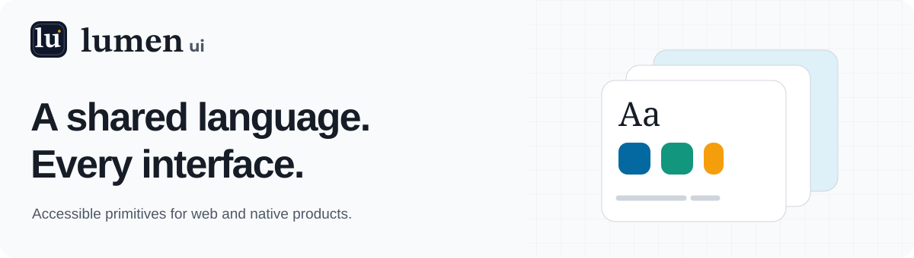
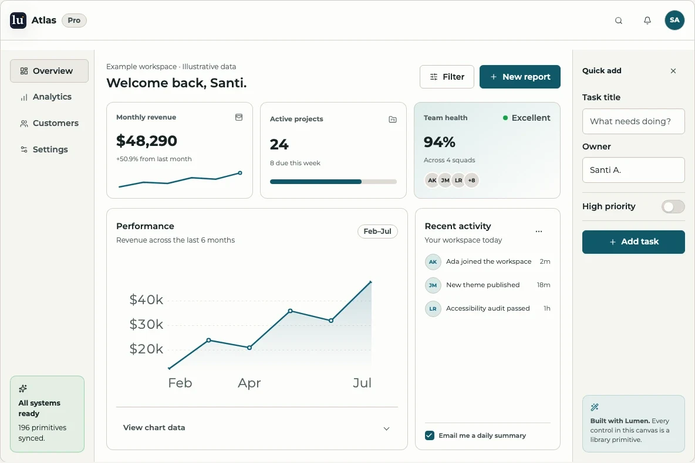
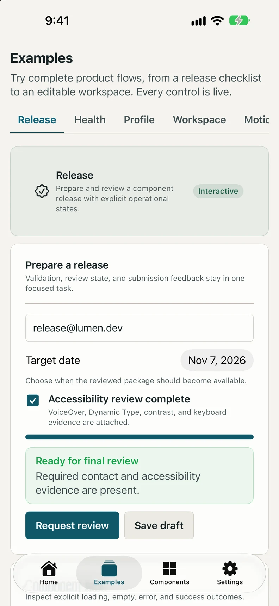
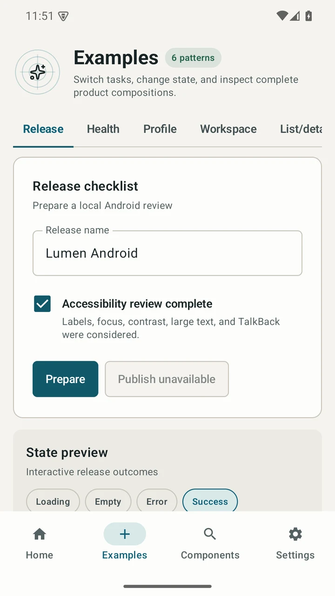
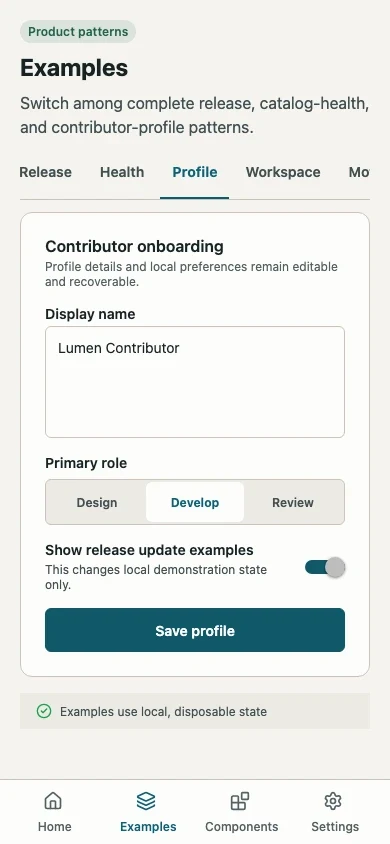

<p align="center">
  <a href="https://lumen.santi020k.com">
    <picture>
      <source media="(prefers-color-scheme: dark)" srcset="./docs/assets/readme/hero-dark.svg">
      
    </picture>
  </a>
</p>

<h1 align="center">Lumen UI</h1>

<p align="center">
  <strong>Accessible primitives. Native authoring. Shared foundations.</strong><br>
  An open-source UI system for Astro, React, Web Components, React Native, SwiftUI, and Jetpack Compose.
</p>

<p align="center">
  <a href="https://lumen.santi020k.com/docs">Documentation</a> ·
  <a href="https://lumen.santi020k.com/docs/components">Components</a> ·
  <a href="https://lumen.santi020k.com/#playgrounds">Playgrounds</a> ·
  <a href="https://lumen.santi020k.com/support">Support</a>
</p>

<p align="center">
  <strong>Figma Community</strong> ·
  <a href="https://www.figma.com/community/file/1662337342676541513/lumen-ui-library-v5">Lumen UI Library</a> ·
  <a href="https://www.figma.com/community/file/1700607667944072280/lumen-templates">Lumen Templates</a> ·
  <a href="https://www.figma.com/community/file/1700608473577262170/lumen-playgrounds">Lumen Playgrounds</a>
</p>

<p align="center">
  <a href="https://github.com/santi020k/lumen/actions/workflows/ci.yml"></a>
  <a href="https://github.com/santi020k/lumen/actions/workflows/codeql.yml"></a>
  <a href="https://www.npmjs.com/package/@santi020k/lumen-astro"></a>
  <a href="./LICENSE"></a>
</p>

## One system, your framework

Build web and native interfaces with shared design tokens, accessible components, and each
platform's own authoring conventions. Astro is the reference implementation.

<p>
  <a href="https://lumen.santi020k.com/docs/web/playground">
    
  </a>
</p>

*Real Lumen components with illustrative data. [Open the web playground →](https://lumen.santi020k.com/docs/web/playground)*

## Start building

Choose your framework, install its adapter, and follow the setup guide for styles and runtime.

| Framework | Setup guide |
| --- | --- |
| **Astro** | [Astro quick start](https://lumen.santi020k.com/docs/frameworks/astro) |
| **React** | [React quick start](https://lumen.santi020k.com/docs/frameworks/react) |
| **Web Components** | [Elements quick start](https://lumen.santi020k.com/docs/frameworks/elements) |
| **React Native** | [React Native guide](https://lumen.santi020k.com/docs/react-native) |
| **SwiftUI** | [Apple guide](https://lumen.santi020k.com/docs/apple) |
| **Jetpack Compose** | [Android guide](https://lumen.santi020k.com/docs/android) |

Astro requires Astro 5+; React requires React 19+. See each guide for supported toolchains
and complete configuration. Browse the [package directory](https://lumen.santi020k.com/docs/packages)
for tokens, icons, integrations, and focused native packages.

> **Upgrading to Lumen 5?** Follow the [migration guide](https://lumen.santi020k.com/docs/migrations/v4-to-v5)
> and [selective installation guide](docs/selective-installation.md). Package versions and store
> builds follow their own release schedules; check availability before upgrading.

## Explore the system

| I want to… | Go to |
| --- | --- |
| Find a component and its API | [Component catalog](https://lumen.santi020k.com/docs/components) |
| Try components, states, and themes | [Web playground](https://lumen.santi020k.com/docs/web/playground) |
| Start from a complete product layout | [Dashboard and app templates](https://lumen.santi020k.com/templates) |
| Customize colors and appearance | [Web themes](https://lumen.santi020k.com/docs/web/themes) · [Theme playground](https://lumen.santi020k.com/docs/theme-playground) |
| Use Tailwind alongside Lumen | [Tailwind integration](https://lumen.santi020k.com/docs/web/tailwind) |
| Build a real screen step by step | [Practical guides](https://lumen.santi020k.com/guides) |
| Understand the shared foundations | [Tokens and platform contracts](https://lumen.santi020k.com/docs/foundations) |

## Try it on native

<table>
  <tr>
    <th>SwiftUI</th>
    <th>Jetpack Compose</th>
    <th>React Native</th>
  </tr>
  <tr>
    <td><a href="https://lumen.santi020k.com/docs/apple/playground"></a></td>
    <td><a href="https://lumen.santi020k.com/docs/android/playground"></a></td>
    <td><a href="https://lumen.santi020k.com/docs/react-native/playground"></a></td>
  </tr>
  <tr>
    <td>Native app capture</td>
    <td>Native app capture</td>
    <td>Expo browser preview</td>
  </tr>
</table>

See [capture provenance](apps/docs/src/assets/platforms/README.md) for sources and verification scope.

[Apple App Store](https://apps.apple.com/app/id6805250815) ·
[Google Play](https://play.google.com/store/apps/details?id=com.santi020k.lumen.playground.compose) ·
[React Native browser preview](https://lumen.santi020k.com/docs/react-native/playground#preview)

For local setup and source, see the [playground guide](docs/playgrounds.md).
Check [native compatibility](docs/native-compatibility.md) and
[device validation evidence](docs/native-device-validation.md) for your target.

## Build with AI and Figma

Give your coding agent Lumen's component selection, composition, and verification guidance:

```bash
npx skills add santi020k/lumen --skill lumen-ui
```

[Agent skill guide](https://lumen.santi020k.com/docs/ai-skill) ·
[MCP catalog](https://lumen.santi020k.com/docs/mcp) ·
[Lumen UI plugin for ChatGPT and Codex](https://chatgpt.com/plugins/plugin_asdk_app_6a8f6c526c5481918eb8a48806fa112b)

Design with the [Figma community library](https://www.figma.com/community/file/1662337342676541513)
and follow the [Figma integration guide](https://lumen.santi020k.com/docs/figma)
for variables and Code Connect. The [local Figma plugin](apps/figma-plugin/README.md) exports
Astro, React and Web Components starters for Lumen releases 5.0.0 and 4.4.0. It also exports React Native and Compose 4.1.0 components and SwiftUI views for iPhone and Mac using the v5.0.0 Swift package.

## Contribute and connect

Read [CONTRIBUTING.md](CONTRIBUTING.md) for local setup, workspace commands, tests, and release rules.
The [architecture guide](docs/cross-platform.md) explains package boundaries and platform responsibilities.

[Feedback and support](https://lumen.santi020k.com/support) ·
[Public roadmap](https://lumen.santi020k.com/support#roadmap) ·
[Community showcase](https://lumen.santi020k.com/community) ·
[Changelog](https://lumen.santi020k.com/changelog)

## License

Lumen's original code and artwork are available under the [MIT License](./LICENSE). Generated
interface icons retain the Lucide ISC or Feather MIT terms, and generated brand icons retain Font
Awesome Free's CC BY 4.0 terms. The native packages include the required attribution and license
notices; see [`icons/THIRD_PARTY_NOTICES.md`](./icons/THIRD_PARTY_NOTICES.md).

Created and maintained by [Santiago Molina](https://santi020k.com).
