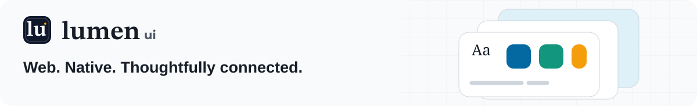

<p align="center">
  <a href="https://lumen.santi020k.com">
    <picture>
      <source media="(prefers-color-scheme: dark)" srcset="../../docs/assets/readme/package-dark.svg">
      
    </picture>
  </a>
</p>

<h1 align="center">Lumen Documentation</h1>

<p align="center">Live examples · Framework guides · Native previews</p>

<p align="center"><a href="https://lumen.santi020k.com">Documentation</a> · <a href="https://lumen.santi020k.com/docs/components">Components</a> · <a href="../../CONTRIBUTING.md">Contributing</a></p>

**On this page:** [Run locally](#run-locally) · [Find the right source](#find-the-right-source) · [Validate and build](#validate-and-build) · [Preview assets and deployment](#preview-assets-and-deployment) · [Resources](#resources)

The public documentation and demonstration site for Lumen UI, built with Astro and the local
workspace packages. This is the reference app for component behavior, theming, and accessibility.

## Run locally

Use Node.js 22.23.4+, 24.15.0+, or 26+ and the pnpm version pinned in the root manifest,
following the [workspace setup requirements](../../CONTRIBUTING.md#local-setup).
From the repository root:

```bash
pnpm install --frozen-lockfile
pnpm exec turbo run build --filter=@santi020k/lumen-docs^...
pnpm run dev
```

Open the URL printed by Astro. The development script builds the Expo web gallery and prepares
its embedded preview before starting the site. Native screenshot previews are committed, so
ordinary docs development does not require Xcode or Android Studio.

## Find the right source

| Location | Responsibility |
| --- | --- |
| `src/pages/docs` | Platform setup, component reference, and playground routes |
| `src/pages/guides` | Task-oriented tutorials |
| `src/examples` | Live component examples and copyable snippets |
| `src/data` | Navigation, guide, component, and search metadata |
| `src/components` and `src/layouts` | Documentation shell and shared page composition |
| `src/styles/global.css` | Documentation theme layered over Lumen tokens |
| `public/native-components` | Optimized native component captures |
| `native-previews` | Small native hosts used to produce reference images |
| `scripts` | Capture synchronization, social images, and deployment packaging |

Use the public Lumen primitive whenever an equivalent exists. Keep a working preview next to its
copyable example. Update navigation and search metadata with new routes; follow the
[documentation contribution guide](../../CONTRIBUTING.md#documentation-and-guides).

## Code examples

`CodeBlock` composes the public editorial `Code` appearance with themed Shiki output. It
previews the first 12 lines when an example exceeds 24 lines, using public `Collapsible` for a
keyboard-accessible disclosure that works without JavaScript. Set `collapsible={false}` when
an example needs to stay fully visible. Copying always uses the original complete source,
independently of the preview, line numbers, and active syntax theme. If clipboard access fails,
a selectable recovery field exposes the complete source without expanding or switching themes. Overflow hints appear only
when horizontal scrolling is needed; printing expands the complete example.

These patterns come from the santi020k v5 website. Shared Code owns the wrapping headers,
stable touch targets, optional editorial presentation, localized clipboard feedback, and print
styles. Preview thresholds and line numbers remain docs policy. Site branding and article-specific
features stay with their application rather than becoming component defaults.

## Reference tables

`DocsReferenceTable` uses the public `Table` sticky first-column option to keep row identifiers
visible during native horizontal scrolling. It retains native table headers and a named keyboard
region, shows the overflow hint only when needed, follows RTL direction, and releases the pinned
column for enlarged text and print output. The behavior comes from the santi020k v5 comparison
tables; the library owns positioning while the docs retain their typography and column sizing.

## Editorial reading surfaces

Migration and theme guides opt into the public `Prose` editorial appearance. The editorial article
guide demonstrates native quotations and figures with public Image, Code, Table, and Link
components. Keep authored IDs, inline markup, captions, and citations in the document; avoid
renderer-specific rewrites for a visual treatment. `--ui-prose-measure` controls paragraph width
without narrowing technical examples or media. Code and chart figures retain their own contracts.

## Validate and build

Run these commands from the repository root:

```bash
pnpm --filter @santi020k/lumen-docs run typecheck
pnpm --filter @santi020k/lumen-docs run test
pnpm --filter @santi020k/lumen-docs run lint
pnpm run docs:build
pnpm --filter @santi020k/lumen-docs run check:og
pnpm --filter @santi020k/lumen-docs run audit:seo
pnpm run docs:preview
```

The root `docs:build` includes workspace dependencies. A direct docs-only build requires those
packages and the Expo web export to have been built first. The post-build step audits metadata
and navigation, then prepares `cloudflare/dist` for Cloudflare Pages.
The docs build also tracks repository-root `docs/**` inputs so edits to imported migration guides
and release highlights invalidate cached HTML.

For visual changes, run `pnpm run test:visual` and the affected interaction/accessibility suites.
Check mobile and desktop, light and dark themes, keyboard navigation, and reduced motion.
Use `pnpm run check:docs-performance` for the documented Lighthouse budgets.

### SEO maintenance

1. Review the Lumen Search Console property before choosing pages to improve. Compare equal
   reporting periods and inspect queries and landing pages together; separate branded searches
   from framework and component searches. Keep account reports out of this public repository.
2. Check indexing reasons and representative URLs. Redirects, intentional `noindex` pages, and
   canonical alternatives are expected exclusions. Confirm the sitemap's last successful read,
   canonical destinations, and HTTP status before changing URLs or requesting validation.
3. Write concise titles that identify the component or task. Describe the actual page content,
   framework, and examples; preserve useful content and stable URLs. Social cards are generated
   from the same metadata. Follow Google's [title guidance](https://developers.google.com/search/docs/appearance/title-link).
4. Run the checks above. The SEO audit validates metadata, sitemap coverage, social cards, and
   links in navigation, documentation content, and search results. Live component previews use
   explicit preview containers so example destinations are excluded from site-link checks.
5. After an authorized deployment, check canonical URLs, redirects, sitemap responses, and a
   real 404 on the live site. Inspect priority pages in Search Console and compare clicks,
   impressions, CTR, and query positions after a few weeks. Record the deployment date and
   reporting windows; a passing local audit does not establish indexing or ranking gains.

## Preview assets and deployment

- [Platform images](src/assets/platforms/README.md) document each screenshot's source.
- [Figma Community artwork](src/assets/figma-community/README.md) catalogs the three covers and their gallery screenshots.
- [Native preview hosts](native-previews/README.md) separate real platform rendering from browser demos.
- [Launch media](public/launch/README.md) explains reproducible campaign assets.

Keep `.astro`, `dist`, `cloudflare/dist`, and temporary captures out of commits. Deployment follows
the [repository release workflow](../../CONTRIBUTING.md#publishing); a successful local build is
not a deployment.

## Resources

- [Repository overview](../../README.md) — framework packages, demos, and the project map.
- [Contributing](../../CONTRIBUTING.md) — workspace setup, validation, and release workflow.
- [Feedback and support](https://lumen.santi020k.com/support) — questions, ideas, and bug reports.

Part of [Lumen UI](https://lumen.santi020k.com), created by [Santiago Molina](https://santi020k.com).
Licensed under [MIT](../../LICENSE); third-party artwork retains its own notices.

## Generated social images

The documentation uses `@santi020k/og` 1.2 presets and a route manifest with content-versioned
image URLs. Generation fingerprints include copy, assets, renderer configuration and the
library version, so regenerated cards invalidate social preview caches. Run the workspace
build to regenerate cards and verify the built metadata, images and sitemap audit.
