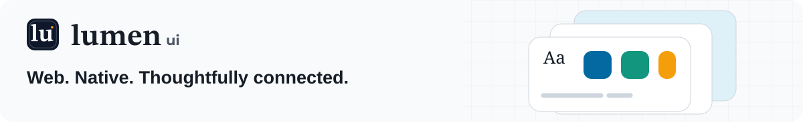

<p align="center">
  <a href="https://lumen.santi020k.com">
    <picture>
      <source media="(prefers-color-scheme: dark)" srcset="../../docs/assets/readme/package-dark.svg">
      
    </picture>
  </a>
</p>

<h1 align="center">Lumen for Figma</h1>

<p align="center">Web and native starters · Structured handoff · Local development plugin</p>

<p align="center"><a href="../../docs/figma.md">Figma integration</a> · <a href="community/LISTING.md">Listing materials</a> · <a href="../../packages/astro/README.md">Astro package</a></p>

**On this page:** [Build and try](#build-and-try) · [Supported conversion](#supported-conversion) · [Local preview and validation](#local-preview-and-validation) · [Maintenance](#maintenance) · [Automated candidates](#automated-candidates) · [Resources](#resources)

**Plugin 1.1.0 · Local installation.** Inspect a frame, component definition, or instance from the canonical Lumen library, review its component matches, and export a starter for the selected platform, integration notes, and structured agent handoff. The plugin runs offline. Only the user decides whether to share design text and properties.

For Astro, choose the exact version of `@santi020k/lumen-astro` used in the receiving project. The selector works offline with these bundled targets. It defaults to **5.0.0** and never inspects or upgrades a project's packages.

| Target | Starter and root layout | Optional appearance |
| --- | --- | --- |
| 5.0.0 | Per-component imports load foundation and component CSS. Mount the progressive runtime once. | Paper, Field, Studio, Glass, santi020k Light or Dark. The layout imports the selected stylesheet. |
| 4.4.0 | Root component exports, full adapter CSS and the v4 runtime. | Studio, Glass, santi020k Light or Dark from the full stylesheet. |

**Use project appearance** preserves the app's palette. Copy the relevant setup into your existing root layout. Keep its metadata, language and theme preferences. Targets describe package contracts. Verify package availability before installation.

## Build and try

From the repository root, use the Node and pnpm versions documented in
[CONTRIBUTING.md](../../CONTRIBUTING.md):

```bash
pnpm install --frozen-lockfile
pnpm exec turbo run build --filter=@santi020k/lumen-figma-plugin
```

In Figma desktop, open **Plugins → Development → Import plugin from manifest** and choose
`apps/figma-plugin/dist/manifest.json`. The manifest deliberately has no invented published plugin
ID. This is a local development build, not a Figma Community listing.

Open a design using the [Lumen library](https://www.figma.com/design/luQW2pTQ3jGGxSFPAAsfa9),
select one frame or component instance, and run **Lumen for Figma**.

1. Choose the **Export target**. Check the supported native adapter version, or choose the Astro version and appearance. Choose **Inspect selection**.
2. Review verified components and unresolved items.
3. Review the platform setup or Astro layout. Copy or save the starter and **AI handoff**. Changing export settings clears the previous output.
4. Give the handoff to a coding agent working in the target repository. It directs the agent to
   check installed Lumen versions, retrieve component contracts, connect application behavior,
   and validate the rendered result.

The plugin does not modify the selected design. It adds a document-level relaunch entry so it can
be opened again. Selection or page edits invalidate the displayed output; inspect again to refresh.

## Supported conversion

### Native targets

| Export target | Exact contract | Deployment target and output |
| --- | --- | --- |
| React Native | `@santi020k/lumen-react-native@4.1.0` | React 19.2+, React Native 0.86.2+, iOS 15.1+ or Android API 24+. Import the named TSX component under your LumenProvider. |
| Android · Jetpack Compose | `com.santi020k:lumen-compose:4.1.0` | Android API 23+. Add the Kotlin file to your app package and call the composable inside LumenTheme. |
| iPhone · SwiftUI | `LumenUI`, Swift package v5.0.0 | Swift tools 6.0, iOS 16+. Present the generated View in your iPhone scene. |
| Mac · SwiftUI | `LumenUI`, Swift package v5.0.0 | Swift tools 6.0, macOS 13+. Use the same shared primitives in a Mac window. |

The native targets support **Button, Input, Field, Card, Badge, Stack, CardTitle, CardDescription and Eyebrow**.
React Native uses the foundations subpath where possible. Each input has independent local editing
state. A Field requires exactly one identified Input. Compose uses a field label and reports a separate
placeholder when it cannot represent it. App actions are left for you to connect.

Nested layouts preserve child order, row/column direction, matching native spacing tokens and
directional padding. Only React Native emits wrapping. Review notes identify approximations,
unknown spacing, icon swaps, and button or badge variants without a native equivalent. A single
recognized text fill can supply a native text tone; other visual overrides require review.
The app owns its theme. Browser presets, Astro versions on the Android or React Native adapters,
Wear OS, and other Apple targets are outside this exporter. If nothing maps, only the handoff
and setup are offered. These are local workspace contracts; check artifact availability separately.

### Astro targets

| Component | Mapped properties | Review still required |
| --- | --- | --- |
| Button | Label, variant, size, loading, disabled | Action behavior and icon swaps |
| Input | Placeholder, visual size | Label, type, name, validation |
| Field | Label, helper visibility/text, one recognized Input | Other control swaps and form rules |
| Card | Title and body | Custom nested content and heading hierarchy |
| Tabs | Three labels and active tab | Panel content and application state |
| Dialog | Title, description, action labels/visibility | Trigger placement, confirmation action |
| Badge, Code | Badge text and variant, inline or multiline code, wrapping, v5 editorial block appearance for Paper and Field | Custom layer overrides and code language |
| CodeTabs | Three labels and code samples, active tab, wrapping and copy control | Sample contents and localization |
| Prose, Callout, Note | Headings, body, list, note label and border | Editorial links and heading levels |
| Timeline | Three event titles, descriptions and times | Real dates and data source |
| CardTitle, CardDescription, Eyebrow, Kbd | Editable text | Heading level, context and key meaning |
| Stack | Direction, gap, wrapping and visible children | Breakpoints and alignment |
| ScrollReveal, RevealGroup | Animation, visible children and group timing, threshold and repeat behavior | Motion, focus and reduced-motion behavior in the app |
| ThemeToggle | Public runtime control, including the selected branded theme pair | Product theme settings and persistence |

Selecting a component set exports its default variant. Select an individual variant or an instance to export its configuration. Handoffs for v5 identify the optional editable recipes for article reading and code examples when the matching components are present.

Known components are matched by observed component or component-set keys, never by layer name
alone. Renaming an instance is supported. Detached instances and duplicated libraries have no
verified identity and require review. Custom layers remain in the handoff and are explicitly
omitted from the starter. Frames become a starting Stack layout; responsive breakpoints, spacing,
alignment, typography, images, and custom visual overrides require review.

The handoff records the target package version, selected structure, layout values, visible text,
properties, paint-variable names, and findings. Color names map through
[`registry/figma-design-map.json`](../../registry/figma-design-map.json). Unbound visible solid paints and unknown
color variables are reported across the complete visible subtree, including recognized instances.
Image and gradient paints do not require semantic solid-color bindings. Check contrast and accessibility in the rendered project.

Astro exports are component fragments. Follow the selected version's **Astro layout** setup at the application boundary. Generated IDs are unique within one export; namespace them
when using multiple copies. No routes, API calls, authorization, or destructive operations are inferred.

The selection limit is 1,500 visible layers, 40 nesting levels, and 100,000 text characters. More than 10,000 findings also requires a smaller selection. Oversized
selections fail with a useful message instead of silently truncating the design.

## Local preview and validation

```bash
pnpm --filter @santi020k/lumen-figma-plugin dev
pnpm --filter @santi020k/lumen-figma-plugin typecheck
pnpm --filter @santi020k/lumen-figma-plugin test
pnpm --filter @santi020k/lumen-figma-plugin lint
pnpm run test:figma-plugin
```

The browser preview is explicitly labeled and uses a synthetic settings screen. It does not connect
to Figma. The browser suite type-checks and builds both generated consumers against the workspace v5 adapter and the pinned published v4.4.0 adapter, then verifies labels,
tabs, dialog focus, downloads, and narrow/desktop layouts. Test the development build in Figma desktop for host permissions, real selections, clipboard
behavior, and downloads before distribution. Browser and mocked-host checks do not establish native
Figma acceptance or Community publication.

To compile generated native code in this checkout, first build the React Native adapter and use
the [native toolchains](../../docs/native-compatibility.md). Run from the repository root:

```bash
pnpm exec turbo run build --filter=@santi020k/lumen-react-native
pnpm --filter @santi020k/lumen-figma-plugin run verify:native react-native
pnpm --filter @santi020k/lumen-figma-plugin run verify:native compose
pnpm --filter @santi020k/lumen-figma-plugin run verify:native apple
```

The checks generate a nested form from observed component keys, with two independent inputs, a
status badge and text that resembles source interpolation. The Expo playground type-checks and
bundles it for iOS and Android. Temporary copies of the Android and Apple playgrounds mount it in
their launch screens and build a debug APK, an iPhone Simulator app and a macOS app. These are build
checks; accessibility and interaction on devices still need testing.

## Maintenance

`src/contracts.ts` holds library keys observed on 2026-10-04 and 2026-11-06. Add keys only after inspecting the canonical owner, variants, and editable properties. Check both Astro releases and exercise new mappings in a generated consumer. Keep the six existing Code Connect templates aligned with their respective components. Component snapshots are design data, never executable code or
instructions. Build output is ignored and reproducible; do not commit `dist/`.

## Automated candidates

The [Figma plugin candidate workflow](../../.github/workflows/figma-plugin.yml) runs on relevant pull
requests and changes merged into `main`. It can also be dispatched in GitHub Actions. It builds,
type-checks, lints, runs the plugin and packaging tests, and verifies the browser export flow and
generated Astro interactions and native consumer builds before uploading an artifact retained for 30 days. It requires no Figma
credentials and has read-only repository permissions.

Each artifact contains a ZIP named with the plugin version and Git revision, a SHA-256 checksum, and
`release.json` with the full source revision, plugin ID, and per-file checksums. The ZIP includes
only the runtime files and release metadata. Pull request artifacts are review candidates; use the
artifact from the approved, merged `main` commit for Community publication.

To reproduce packaging locally after building workspace dependencies:

```bash
pnpm --filter @santi020k/lumen-figma-plugin run package
```

Packaging uses the system `zip` command (macOS and Ubuntu runners include it). Packaging tests also
use `unzip`. Output goes to `dist/artifacts/`. Local changes add `-dirty` to the ZIP name and set
`dirty: true` in its metadata. CI refuses to package a dirty checkout. A missing Figma plugin ID
produces a development candidate, never a claim of Community readiness.

## Figma Community publication

Plugin 1.1.0 is a local build. Figma Community submission, approval and public installation each require separate evidence. The Community design-library link opens the library file.

1. Verify availability of each target package, Maven artifact or Swift tag and its public setup documentation. Register the plugin with the intended publisher in Figma desktop and commit the assigned ID through the normal reviewed release workflow.
2. From the approved merged `main` revision, download the Actions candidate, check its ZIP against the adjacent SHA-256 file and verify the revision, plugin version, ID and clean status in `release.json`.
3. Import that manifest in Figma desktop. Inspect canonical instances and detached copies, empty and multiple selections, text overrides, both Astro versions, an appearance change and all four native targets. Check clipboard, file downloads, tab navigation and dialog focus in the receiving app. Record the desktop version, revision, checksum and results in the release PR.
4. Review the [listing and data practices](community/LISTING.md). Submit the verified candidate through [Figma desktop](https://help.figma.com/hc/en-us/articles/360042293394-Publish-classic-plugins-to-the-Figma-Community). Record the review outcome, install from the approved listing, and repeat an export before adding the public install URL to the docs.

### Updates and recovery

For subsequent updates, increment this app's version, describe changes in the reviewed release PR,
and repeat the automated candidate and desktop publishing steps. Preserve the approved ZIP and
checksums before Actions retention expires. Follow the repository release workflow; do not publish
from an unmerged local checkout. No GitHub secret, remote JavaScript loader, or paid runner is needed.

For recovery, republish the last verified bundle through Figma desktop, retaining its source
revision and recording the rollback in the listing's version notes. Figma distributes updates to
all users and does not let them select an older version; see [plugin version management](https://developers.figma.com/docs/plugins/#plugin-management).

## Resources

- [Repository overview](../../README.md) — framework packages, demos, and the project map.
- [Contributing](../../CONTRIBUTING.md) — workspace setup, validation, and release workflow.
- [Feedback and support](https://lumen.santi020k.com/support) — questions, ideas, and bug reports.

Part of [Lumen UI](https://lumen.santi020k.com), created by [Santiago Molina](https://santi020k.com).
Licensed under [MIT](../../LICENSE); third-party artwork retains its own notices.
